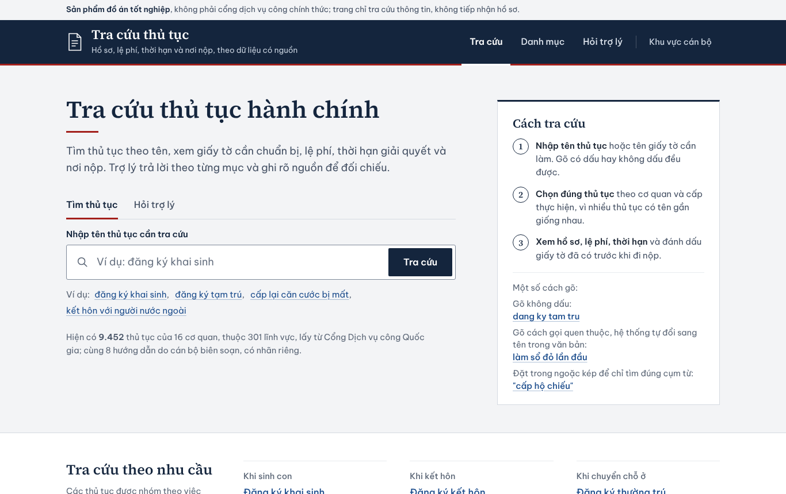
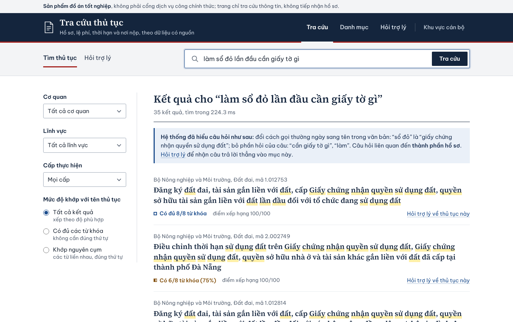
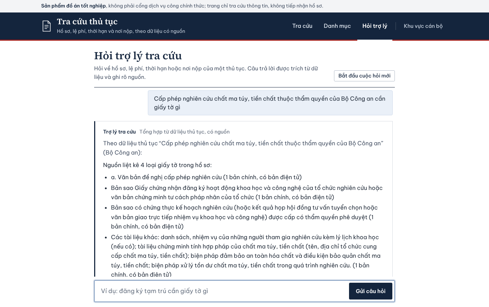
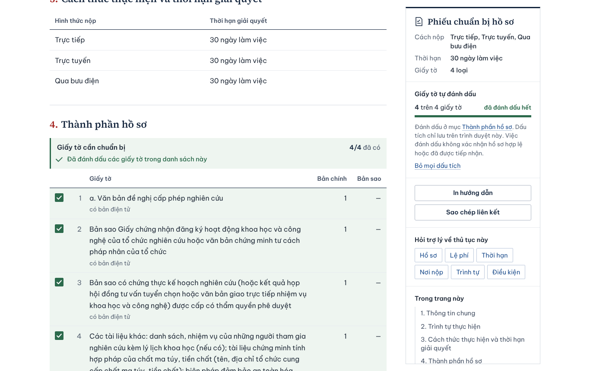
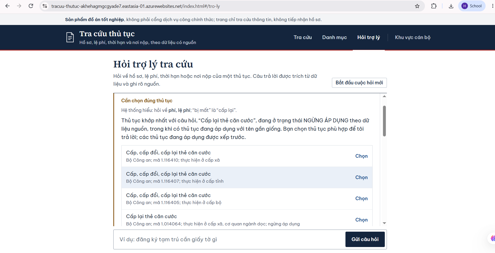
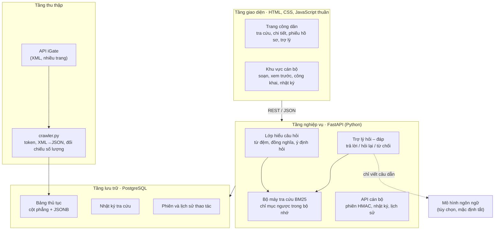

# Hệ thống tra cứu thông minh và trợ lý AI hỗ trợ tra cứu hướng dẫn thủ tục hành chính công

Trang web giúp người dân **tìm đúng thủ tục hành chính** dù không nhớ tên chính thức, và **hỏi đáp về hồ sơ, lệ phí, thời hạn** với câu trả lời trích nguyên văn từ dữ liệu nguồn, luôn kèm dẫn nguồn. Cán bộ có khu vực riêng để soạn, xem trước, công khai hướng dẫn và theo dõi nhu cầu tra cứu.

Sản phẩm của **khóa luận tốt nghiệp – học kỳ doanh nghiệp** (2026), thực hiện tại Trung tâm Kinh doanh Giải pháp, VNPT Gia Lai, trên **9.451 thủ tục thật** lấy từ hệ thống iGate.

> **Lưu ý:** đây là sản phẩm đồ án, **không phải cổng dịch vụ công chính thức** và không tiếp nhận hồ sơ. Thông tin thủ tục cần được đối chiếu với nguồn công bố hiện hành trước khi sử dụng.

| | |
|---|---|
| Sinh viên | Phạm Duy Hoàng, chuyên ngành Khoa học máy tính, Đại học UEH – Trường Công nghệ và Thiết kế |
| Giảng viên hướng dẫn | TS. Nguyễn Đăng Cao |
| Người hướng dẫn tại doanh nghiệp | Anh Phan Duy Nghĩa, Trung tâm Kinh doanh Giải pháp, VNPT Gia Lai |



## Mục lục

1. [Bài toán và cách tiếp cận](#1-bài-toán-và-cách-tiếp-cận)
2. [Tính năng](#2-tính-năng)
3. [Kiến trúc](#3-kiến-trúc)
4. [Công nghệ](#4-công-nghệ)
5. [Cấu trúc thư mục](#5-cấu-trúc-thư-mục)
6. [Chạy nhanh trên máy cá nhân (không cần PostgreSQL)](#6-chạy-nhanh-trên-máy-cá-nhân-không-cần-postgresql)
7. [Chạy đầy đủ với PostgreSQL](#7-chạy-đầy-đủ-với-postgresql)
8. [Cấu hình `.env`](#8-cấu-hình-env)
9. [Kiểm thử](#9-kiểm-thử)
10. [Tái lập các số đo trong khóa luận](#10-tái-lập-các-số-đo-trong-khóa-luận)
11. [Triển khai lên máy chủ](#11-triển-khai-lên-máy-chủ)
12. [Kết quả chính](#12-kết-quả-chính)
13. [Hạn chế đã biết và hướng phát triển](#13-hạn-chế-đã-biết-và-hướng-phát-triển)
14. [Bảo mật và dữ liệu](#14-bảo-mật-và-dữ-liệu)
15. [Tài liệu kèm theo](#15-tài-liệu-kèm-theo)
16. [Lời cảm ơn và bản quyền](#16-lời-cảm-ơn-và-bản-quyền)

---

## 1. Bài toán và cách tiếp cận

Người dân thường không biết tên chính thức của thủ tục: họ gõ “làm sổ đỏ” chứ không gõ “cấp giấy chứng nhận quyền sử dụng đất”, gõ không dấu hoặc sai thứ tự từ. Một ô tìm kiếm khớp chữ thông thường sẽ trả về rỗng hoặc sai. Mặt khác, nếu dùng chatbot sinh văn bản tự do, mô hình có thể bịa ra lệ phí hay thời hạn, điều rất nguy hiểm với thủ tục hành chính.

Đồ án chọn hướng **“đúng quan trọng hơn hay”**:

- **Tra cứu:** thuật toán **BM25 tự cài đặt, điều chỉnh cho tiếng Việt** (âm tiết, cặp âm tiết, xử lý dấu, chuẩn hóa Unicode), cộng một **lớp hiểu câu hỏi đời thường** (bỏ từ đệm, đổi từ đồng nghĩa như “sổ đỏ”, “bằng lái”, “visa”).
- **Trợ lý:** theo tinh thần RAG nhưng **trích xuất thay vì sinh**: truy xuất thủ tục trước, rồi chép nguyên phần hồ sơ, lệ phí, thời hạn từ dữ liệu có cấu trúc. Trợ lý **hỏi lại** khi các thủ tục đầu bảng gần giống nhau hoặc thủ tục khớp nhất đã ngừng áp dụng, và **từ chối** câu ngoài phạm vi. Mô hình ngôn ngữ lớn chỉ là lớp tùy chọn (mặc định tắt), chỉ được viết câu dẫn và bị kiểm soát bằng danh sách từ cho phép.
- **Đánh giá có kiểm chứng:** mọi thay đổi thuật toán đều qua bộ đo (Top-k, MRR, bộ câu ngoài phạm vi, tập kiểm tra soạn trước). Riêng độ chính xác của câu trả lời được kiểm bằng một **bộ đối chiếu nguồn độc lập**, và bản thân bộ đối chiếu lại được kiểm bằng lỗi cố ý.

## 2. Tính năng

**Người dân (không cần đăng nhập)**

- Tra cứu với 4 kiểu khớp: trùng khớp tên, khớp nguyên cụm, chứa đủ từ khóa, khớp một phần. Hỗ trợ câu không dấu và tìm nguyên cụm bằng ngoặc kép.
- Hộp “Hệ thống đã hiểu câu hỏi như sau” giải thích hệ thống đã đổi câu hỏi ra sao.
- Lọc theo cơ quan, lĩnh vực, cấp thực hiện và mức độ khớp; gợi ý trong lúc gõ.
- Trang chi tiết có hai chế độ “Hướng dẫn” và “Nguyên bản API”, các mục xếp theo Điều 8 Nghị định 63/2010/NĐ-CP.
- Phiếu chuẩn bị hồ sơ: tích giấy tờ đã có, lưu ngay trong trình duyệt.
- Trợ lý hỏi đáp nhiều lượt, có dẫn nguồn, hỏi lại khi chưa chắc, từ chối câu ngoài phạm vi.

**Cán bộ (đăng nhập)**

- Soạn, lưu nháp, xem trước như người dân, công khai, ngừng công khai, lưu trữ. Không xóa cứng; sửa bản đang công khai thì tự về nháp.
- Nhật ký tra cứu (câu tra nhiều, câu không có kết quả), nút “Soạn hướng dẫn” từ câu không có kết quả.
- Lịch sử thao tác: ai làm gì, lúc nào.

**Vận hành**

- Phiên đăng nhập ký HMAC, hết hạn sau 8 giờ, đăng xuất thu hồi phiên thật sự.
- Khóa đăng nhập sai theo IP, giới hạn tần suất gọi API, tiêu đề bảo mật HTTP.
- Nhật ký che số định danh, email; tự xóa sau 180 ngày; không lưu IP.
- Hai địa chỉ kiểm tra: `/health` (kết nối database) và `/san-sang` (chỉ mục đã nạp, sẵn sàng phục vụ).
- Công cụ chuyển dữ liệu một giao dịch, tự đối chiếu bằng mã băm; công cụ đóng gói cho Azure tự loại tệp chứa mật khẩu.

| Kết quả tra cứu | Trợ lý trả lời có dẫn nguồn |
|---|---|
|  |  |
| **Trang chi tiết và phiếu chuẩn bị hồ sơ** | **Trợ lý hỏi lại, ưu tiên thủ tục đang áp dụng** |
|  |  |

## 3. Kiến trúc



Đường đi của một câu hỏi gửi trợ lý: `POST /api/hoi` → nhận diện câu giao tiếp → lớp hiểu câu hỏi xác định ý định (hồ sơ, lệ phí, thời hạn…) và sinh tối đa 4 biến thể → BM25 xếp hạng trên toàn kho → trợ lý quyết định trả lời (khớp ≥ 60% và không có thủ tục gần giống hay đang áp dụng thay thế), hỏi lại, hoặc từ chối → trích nguyên mục dữ liệu từ cột JSONB, kèm mã thủ tục và nguồn → ghi nhật ký sau khi che dữ liệu cá nhân.

## 4. Công nghệ

| Thành phần | Công nghệ |
|---|---|
| Ngôn ngữ, máy chủ | Python 3.10–3.13, FastAPI 0.115, Uvicorn 0.30 |
| Cơ sở dữ liệu | PostgreSQL (đã dùng 16 và 18), SQLAlchemy 2.0, kiểu JSONB; SQLite cho chế độ demo và kiểm thử |
| Tra cứu | BM25 tự cài đặt (k₁ = 1,5; b = 0,75), chỉ mục ngược trong bộ nhớ, không cần GPU |
| Giao diện | HTML, CSS, JavaScript thuần; phông Source Serif 4 và Be Vietnam Pro lưu kèm (chạy được khi không có Internet) |
| Kiểm thử | TestClient của FastAPI trên SQLite tạm; Playwright cho kiểm thử trình duyệt |
| Triển khai | Azure App Service (Linux) + Azure Database for PostgreSQL; có sẵn Dockerfile và cấu hình Render |

## 5. Cấu trúc thư mục

```text
.
├── README.md                     ← tệp này
├── backend/
│   ├── app/                      ← mã máy chủ
│   │   ├── main.py               ← ứng dụng FastAPI, API công dân, /health, /san-sang
│   │   ├── search.py             ← bộ máy tra cứu BM25 cho tiếng Việt
│   │   ├── hieu_truy_van.py      ← lớp hiểu câu hỏi: từ đệm, đồng nghĩa, ý định
│   │   ├── tro_ly.py             ← trợ lý: trả lời / hỏi lại / từ chối, trích xuất có dẫn nguồn
│   │   ├── giao_tiep.py          ← đáp lời chào, cám ơn, “bạn là ai”
│   │   ├── mo_hinh_ngon_ngu.py   ← lớp mô hình ngôn ngữ tùy chọn, kiểm soát bằng danh sách cho phép
│   │   ├── quan_tri.py           ← khu vực cán bộ: đăng nhập, soạn, công khai, nhật ký, lịch sử
│   │   ├── an_danh.py            ← che số định danh, email trong nhật ký
│   │   ├── mang.py               ← xác định IP sau proxy, giới hạn tần suất
│   │   ├── xml_parser.py         ← chuyển XML của API nguồn sang JSON
│   │   └── models.py, database.py, schemas.py
│   ├── chay_demo.py              ← chạy thử không cần PostgreSQL
│   ├── nap_du_lieu_mau.py        ← nạp bộ dữ liệu mẫu vào database
│   ├── tai_lap_so_do.py          ← chạy lại các phép đo trên dữ liệu mẫu
│   ├── crawler.py                ← thu thập dữ liệu thật từ API (cần tài khoản do đơn vị cấp)
│   ├── chuyen_du_lieu.py         ← chép dữ liệu từ máy lên máy chủ, một giao dịch
│   ├── danh_gia*.py              ← bộ đo A/B/C, câu tự nhiên, trợ lý, quy tắc hỏi lại
│   ├── doi_chieu_nguon.py, kiem_tra_bo_doi_chieu.py  ← bộ đối chiếu nguồn và kiểm thử bằng lỗi cố ý
│   ├── kiem_thu_api.py           ← 159 phép thử API
│   ├── test_bo_de.py             ← 44 ca kiểm thử bộ đọc tệp đề
│   ├── kiem_thu_giao_dien.py     ← 41 phép thử trình duyệt (Playwright)
│   ├── requirements.txt
│   └── .env.example              ← mẫu cấu hình; chép thành .env
├── frontend/                     ← index.html (công dân), quan_tri.html (cán bộ), CSS, phông chữ
├── du_lieu_mau/                  ← kho 9.451 thủ tục dùng để đo + 21 thủ tục có dữ liệu chi tiết
├── bo_de_tu_nhien/               ← các bộ câu hỏi tự nhiên, ngoài phạm vi, trợ lý (CSV)
├── bao_cao/                      ← kết quả đo và kiểm thử của từng phiên bản (minh chứng của khóa luận)
├── khao_sat_nguoi_dung/          ← hướng dẫn khảo sát, phiếu SUS, công cụ tính điểm
├── docs/
│   ├── anh/                      ← ảnh giao diện
│   ├── HUONG_DAN_DUA_LEN_GITHUB.md
│   └── nhat_ky_phat_trien/       ← hướng dẫn triển khai lên Azure (19_TRIEN_KHAI_AZURE.md)
├── Dockerfile, render.yaml       ← đóng gói cho Docker / Render
├── dong_goi_azure.py             ← tạo gói đưa lên Azure App Service (tự loại .env)
└── requirements.txt              ← trỏ tới backend/requirements.txt (Azure chỉ tìm ở thư mục gốc)
```

## 6. Chạy nhanh trên máy cá nhân (không cần PostgreSQL)

Cách này dành cho xem thử và chấm bài: không cần cài PostgreSQL, không cần tài khoản API. Lần đầu chạy, hệ thống tự tạo tệp SQLite `backend/du_lieu_demo.db` và nạp **đúng kho 9.451 thủ tục đã dùng để đo** trong khóa luận.

**Yêu cầu:** Python 3.10–3.13 (khuyến nghị 3.12). Khi cài Python trên Windows, tích ô *Add Python to PATH*.

**Windows (CMD):**

```bat
cd backend
python -m venv venv
venv\Scripts\activate
pip install -r requirements.txt
set PYTHONUTF8=1
python chay_demo.py
```

**macOS / Linux:**

```bash
cd backend
python3 -m venv venv
source venv/bin/activate
pip install -r requirements.txt
export PYTHONUTF8=1
python chay_demo.py
```

Sau đó mở trình duyệt:

| Địa chỉ | Nội dung |
|---|---|
| http://127.0.0.1:8000/ | Trang công dân |
| http://127.0.0.1:8000/quan_tri.html | Khu vực cán bộ |
| http://127.0.0.1:8000/docs | Tài liệu API tương tác (FastAPI tự sinh) |

Câu nên thử ở ô tra cứu: `làm sổ đỏ` (12 kết quả, có hộp giải thích “sổ đỏ” → “giấy chứng nhận quyền sử dụng đất”), `cap lai ho chieu` (gõ không dấu), `cách nấu phở bò` (hệ thống trả lời không có). Ở trang trợ lý, hỏi về một thủ tục có dữ liệu chi tiết, ví dụ `Gia hạn giấy phép sản xuất chất ma túy mất bao lâu?`, rồi hỏi tiếp `còn hồ sơ thì sao`.

**Lưu ý về dữ liệu mẫu:** cả 9.451 thủ tục đều tra cứu được, nhưng chỉ **20 thủ tục** (chủ yếu của Bộ Công an) có nội dung chi tiết đầy đủ (hồ sơ, lệ phí, thời hạn). Với các thủ tục còn lại, trang chi tiết và trợ lý chỉ có tên, cơ quan, lĩnh vực. Bản chạy thật có đủ nội dung nhờ thu thập bằng `crawler.py`.

**Mở khu vực cán bộ:** chép `backend/.env.example` thành `backend/.env`, rồi đặt `QUAN_TRI_TAI_KHOAN` và `QUAN_TRI_MAT_KHAU`. Ở chế độ demo, dòng `DATABASE_URL` trong `.env` được bỏ qua.

Muốn làm lại từ đầu: tắt máy chủ (Ctrl+C), xóa `backend/du_lieu_demo.db`, chạy lại `python chay_demo.py`. Đổi cổng: `python chay_demo.py --cong 8080`.

## 7. Chạy đầy đủ với PostgreSQL

Đây là cấu hình đã dùng khi phát triển (Windows 10 + PostgreSQL 18) và khi chạy thật trên Azure.

1. **Cài PostgreSQL** (bản 14 trở lên) và tạo database:

   ```sql
   CREATE DATABASE guidance_db;
   ```

2. **Cài thư viện** như mục 6 (tạo `venv`, `pip install -r requirements.txt`).

3. **Tạo `backend/.env`** từ `backend/.env.example`, điền tối thiểu:

   ```ini
   DATABASE_URL=postgresql://postgres:<mật khẩu>@localhost:5432/guidance_db
   QUAN_TRI_TAI_KHOAN=<tài khoản cán bộ tự đặt>
   QUAN_TRI_MAT_KHAU=<mật khẩu đủ mạnh>
   BI_MAT_PHIEN=<một chuỗi ngẫu nhiên dài>
   ```

4. **Nạp dữ liệu**, chọn một trong hai cách:

   - Dữ liệu mẫu (không cần tài khoản API): `python nap_du_lieu_mau.py`. Script chỉ nạp vào bảng trống, không sửa, không xóa gì.
   - Dữ liệu thật: điền `DVC_*` trong `.env` bằng thông tin do đơn vị quản lý dữ liệu cấp, rồi chạy `python crawler.py` (hoặc `python crawler.py G01` để thử với một cơ quan). Bộ thu thập đối chiếu số lượng theo từng cơ quan và dừng nếu gặp dữ liệu bất thường.

5. **Chạy máy chủ** (trong thư mục `backend`, đã kích hoạt `venv`):

   ```bat
   set PYTHONUTF8=1
   uvicorn app.main:app --host 127.0.0.1 --port 8000
   ```

   Chỉ chạy **một** tiến trình (không dùng `--workers` > 1): bộ đếm lượt, khóa đăng nhập sai và danh sách phiên đã thu hồi nằm trong bộ nhớ tiến trình.

6. **Kiểm tra:** http://127.0.0.1:8000/san-sang phải trả `"san_sang": true`.

## 8. Cấu hình `.env`

Mọi bí mật đọc từ `backend/.env` (trên máy) hoặc biến môi trường (trên máy chủ). Tệp `.env` đã nằm trong `.gitignore`.

| Biến | Bắt buộc | Ý nghĩa |
|---|---|---|
| `DATABASE_URL` | Có (trừ chế độ demo) | Chuỗi kết nối PostgreSQL; nhận cả dạng `postgres://` |
| `QUAN_TRI_TAI_KHOAN`, `QUAN_TRI_MAT_KHAU` | Để mở khu vực cán bộ | Để trống thì khu vực cán bộ bị khóa |
| `BI_MAT_PHIEN` | Nên đặt | Khóa ký phiên HMAC; để trống thì tự sinh mỗi lần khởi động (mọi phiên mất khi khởi động lại) |
| `DVC_TOKEN_URL`, `DVC_CLIENT_ID`, `DVC_USERNAME`, `DVC_PASSWORD`, `DVC_PROCEDURES_URL` | Chỉ khi thu thập | Thông tin API nguồn do đơn vị quản lý dữ liệu cấp |
| `LLM_BASE_URL`, `LLM_MODEL`, `LLM_API_KEY` | Không | Bật lớp mô hình ngôn ngữ (API tương thích OpenAI, ví dụ Ollama tại máy); để trống là tắt |
| `GIOI_HAN_MOI_PHUT` | Không | Số lượt/phút mỗi IP (0 = tắt); bản trên Azure dùng 60 |
| `SO_PROXY_TIN_CAY` | Khi chạy sau proxy | Số lớp proxy tin cậy để xác định IP thật (Azure App Service: 1) |
| `NHAT_KY_GIU_NGAY` | Không | Số ngày giữ nhật ký tra cứu (mặc định 180) |
| `CORS_ORIGINS` | Không | Chỉ cho trang ở tên miền này gọi API từ trình duyệt |
| `HIEU_CAU_HOI` | Không | Đặt `0` để tắt lớp hiểu câu hỏi (kết quả giống bản trước khi có lớp này) |

## 9. Kiểm thử

Chạy trong thư mục `backend`, đã kích hoạt `venv` và đặt `PYTHONUTF8=1`. Hai bộ đầu dùng database SQLite tạm, **không chạm dữ liệu thật**.

```bat
python kiem_thu_api.py          :: kết quả mong đợi: 159/159 phép thử đạt
python test_bo_de.py            :: kết quả mong đợi: 44/44 ca đạt
python kiem_tra_bo_doi_chieu.py :: kiểm thử bộ đối chiếu nguồn bằng 14 kiểu lỗi cố ý (chạy vài phút)
```

Đã chạy đạt trên Python 3.10, 3.12 và 3.13. Ở `kiem_tra_bo_doi_chieu.py`, 13 kiểu lỗi bị phát hiện 100%; riêng kiểu “Miễn lệ phí.” (không có chữ số) là 0%. Đây là giới hạn đã biết của phương pháp đối chiếu theo chuỗi, không phải lỗi.

**Kiểm thử giao diện (tùy chọn, 41 phép thử):** cài Playwright một lần, rồi chạy ở cửa sổ thứ hai trong khi máy chủ đang chạy:

```bat
pip install playwright==1.56.0
python -m playwright install chromium
python kiem_thu_giao_dien.py --tk <tài khoản cán bộ> --mk <mật khẩu cán bộ>
```

## 10. Tái lập các số đo trong khóa luận

Kho mẫu trong `du_lieu_mau/` chính là kho dùng để đo (mã băm SHA-256 `2319b44b…f8de685`, trùng Phụ lục C của khóa luận). Vì vậy có thể chạy lại các phép đo tra cứu và trợ lý mà không cần PostgreSQL:

```bat
python tai_lap_so_do.py                                                          :: bộ A/B/C, khoảng 1 phút
python tai_lap_so_do.py danh_gia_tu_nhien.py --file ../bo_de_tu_nhien/bo_de_kiem_tra_doc_lap.csv
python tai_lap_so_do.py danh_gia_tro_ly.py
```

| Phép đo | Kết quả mong đợi |
|---|---|
| Bộ A (500 truy vấn) | Top-1 90,8%, Top-5 99,8%, MRR 0,950 |
| Bộ B (500 truy vấn) | Top-1 72,0%, Top-5 97,2%, MRR 0,827 |
| Bộ C (500 truy vấn) | Top-1 21,6%, Top-5 49,0%, MRR 0,342 |
| Bộ kiểm tra độc lập (32 câu) | Top-1 71,9%, Top-5 84,4%, MRR 0,787, trả về rỗng 0/32 |
| Trợ lý, 30 câu trong phạm vi | trả lời thẳng 23, hỏi lại 7, từ chối nhầm 0 |
| Trợ lý, 30 câu ngoài phạm vi | từ chối 25, hỏi lại 4, trả lời nhầm 1 |

Các con số trên đã được chạy lại từ chính kho mã này. Bộ đo A/B/C dùng hạt giống ngẫu nhiên cố định, nên lần nào cũng ra cùng kết quả.

## 11. Triển khai lên máy chủ

- **Azure for Students (cách đang dùng):** App Service Linux, Python 3.12, gói B1, bật Always on; Azure Database for PostgreSQL flexible server. Hướng dẫn từng bước, kèm xử lý lỗi thường gặp: [`docs/nhat_ky_phat_trien/19_TRIEN_KHAI_AZURE.md`](docs/nhat_ky_phat_trien/19_TRIEN_KHAI_AZURE.md). Tạo gói đưa lên bằng `python dong_goi_azure.py`; gói tự kiểm tra để không chứa `.env`.
- **Docker / Render:** `Dockerfile` (đọc chuỗi kết nối từ biến `DATABASE_URL`, cổng từ biến `PORT`) và `render.yaml` (một dịch vụ web và một database PostgreSQL) có sẵn. Lưu ý gói miễn phí của Render cho dịch vụ ngủ sau 15 phút không có truy cập và xóa database sau 30 ngày.
- **Chuyển dữ liệu từ máy lên máy chủ:** `python chuyen_du_lieu.py` (chỉ đọc ở nguồn, dừng nếu nguồn và đích là cùng một database, chép trong một giao dịch, đối chiếu mã băm trước khi lưu).

Trên máy chủ, mọi bí mật khai báo trong phần cấu hình biến môi trường của dịch vụ, không đưa vào mã.

## 12. Kết quả chính

| Hạng mục | Kết quả |
|---|---|
| Dữ liệu | 9.451 thủ tục, 15 cơ quan, 301 lĩnh vực (bản xuất 24/09/2026) |
| Tra cứu theo tên | Bộ A Top-1 90,8%; bộ B Top-1 72,0%, Top-5 97,2% |
| Câu hỏi đời thường | Bộ kiểm tra độc lập Top-5 75,0% → 84,4% nhờ lớp hiểu câu hỏi; câu trả về rỗng 12/82 → 0/82 |
| Trợ lý (30 câu trong phạm vi) | Đúng ngay 20, sai 3, hỏi lại 7; có đáp án sau tối đa một lần chọn 26/30 |
| Quy tắc hỏi lại | Số câu khẳng định nhầm thủ tục 6 → 3 (bộ trợ lý), 12 → 4 (bộ phát triển) |
| Đối chiếu nguồn (21 thủ tục) | 576/576 dữ kiện có mặt; 0/544 dòng không có căn cứ |
| Kiểm thử | 159/159 API, 44/44 bộ đọc tệp đề, 41/41 giao diện |
| Triển khai | Chạy thật trên Azure; chuyển dữ liệu 9.451/9.451, mã băm khớp |

## 13. Hạn chế đã biết và hướng phát triển

- Còn chọn nhầm giữa các thủ tục có tên gần giống nhau (ví dụ “làm hộ chiếu” ra hộ chiếu ngoại giao, công vụ).
- Lớp hiểu câu hỏi dựa trên từ điển: mới tìm được 5/10 câu dùng từ đồng nghĩa không có trong bảng; chưa có tìm kiếm ngữ nghĩa bằng vector.
- Nhãn đáp án của các bộ câu hỏi tự nhiên chưa được người hiểu nghiệp vụ duyệt lại; bộ kiểm tra độc lập còn nhỏ (32 câu).
- Bộ đối chiếu nguồn so theo con số và chuỗi ký tự, chưa bắt được khẳng định không có chữ số.
- Mới có một tài khoản cán bộ chung, chưa phân quyền soạn/duyệt; chưa đo tải nhiều người dùng; chưa khảo sát người dùng thật (bộ khảo sát SUS đã chuẩn bị trong `khao_sat_nguoi_dung/`).

Hướng phát triển theo thứ tự ưu tiên: duyệt nhãn và khảo sát người dùng thật; xử lý các tình huống lỗi hiếm gặp; tận dụng đối tượng, cấp thực hiện và loại hành động để giảm chọn nhầm; thử tìm kiếm lai BM25 + ngữ nghĩa và chỉ giữ nếu tập kiểm tra tăng mà khả năng từ chối không giảm; nhiều tài khoản cán bộ với vai trò soạn và duyệt riêng.

## 14. Bảo mật và dữ liệu

- **Không bao giờ commit `backend/.env`** (mật khẩu database, tài khoản API, tài khoản cán bộ, khóa ký phiên). `.gitignore` đã chặn sẵn; trước mỗi lần `git push`, chạy `git status` để chắc chắn không có tệp `.env` nào. Hướng dẫn chi tiết: [`docs/HUONG_DAN_DUA_LEN_GITHUB.md`](docs/HUONG_DAN_DUA_LEN_GITHUB.md).
- Kho mã không chứa địa chỉ API nguồn, tài khoản hay mật khẩu nào. Thông tin truy cập API do đơn vị quản lý dữ liệu cấp và chỉ được đặt trong `.env`.
- Dữ liệu trong `du_lieu_mau/` và `bao_cao/` là thông tin thủ tục hành chính, được lấy với quyền truy cập do VNPT Gia Lai cấp trong khuôn khổ đợt thực tập. Trước khi để kho mã ở chế độ **công khai (Public)**, cần hỏi ý kiến đơn vị thực tập.
- Phát hiện vấn đề bảo mật: vui lòng liên hệ trực tiếp tác giả thay vì mở issue công khai.

## 15. Tài liệu kèm theo

| Tài liệu | Nội dung |
|---|---|
| [`docs/nhat_ky_phat_trien/19_TRIEN_KHAI_AZURE.md`](docs/nhat_ky_phat_trien/19_TRIEN_KHAI_AZURE.md) | Hướng dẫn từng bước đưa hệ thống lên Azure for Students và kết quả chạy thật |
| [`bao_cao/`](bao_cao/) | Kết quả đo và kiểm thử của từng phiên bản, là minh chứng cho các số liệu trong khóa luận |
| [`bo_de_tu_nhien/HUONG_DAN_GAN_NHAN.md`](bo_de_tu_nhien/HUONG_DAN_GAN_NHAN.md) | Cách gán nhãn bộ câu hỏi tự nhiên |
| [`khao_sat_nguoi_dung/HUONG_DAN_KHAO_SAT.md`](khao_sat_nguoi_dung/HUONG_DAN_KHAO_SAT.md) | Kế hoạch khảo sát người dùng và cách tính điểm SUS |

## 16. Lời cảm ơn và bản quyền

Xin cám ơn TS. Nguyễn Đăng Cao, quý thầy cô Khoa Công nghệ thông tin kinh doanh, Đại học UEH – Trường Công nghệ và Thiết kế, và Trung tâm Kinh doanh Giải pháp, VNPT Gia Lai, đặc biệt là anh Phan Duy Nghĩa, đã hướng dẫn và tạo điều kiện cho đồ án.

© 2026 Phạm Duy Hoàng. Mã nguồn được công bố phục vụ học tập và chấm khóa luận. Kho mã chưa gắn giấy phép mã nguồn mở, nên mọi quyền được giữ lại; muốn sử dụng lại, vui lòng liên hệ tác giả. Dữ liệu thủ tục hành chính thuộc các cơ quan công bố.
